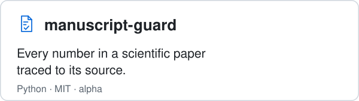
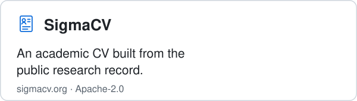
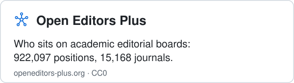
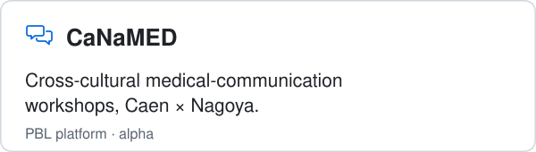

<picture>
  <source media="(prefers-color-scheme: dark)" srcset="assets/header-dark.svg">
  
</picture>

Pharmacologist (PharmD, MSc, MPH) and PhD candidate at Nagoya University Graduate School of Medicine. I work on drug safety and pharmacoepidemiology, and I build free, open tools for the way research is written, checked and credited.

**Research interests:** pharmacovigilance and pharmacoepidemiology (disproportionality analyses of VigiBase), research integrity and reproducible manuscripts, open research information, and medical education.

**Currently:** a PhD at Nagoya University on machine-learning-driven adaptive problem-based learning in psychopharmacology, a Franco-Japanese collaboration funded by Nagoya University (2025–2029); and building reference-currency checks into manuscript-guard.

**Languages:** French, English, Japanese.

**What I build**

<a href="https://github.com/BasileChretien/manuscript-guard"><picture><source media="(prefers-color-scheme: dark)" srcset="assets/card-manuscript-guard-dark.svg"></picture></a>
<a href="https://sigmacv.org"><picture><source media="(prefers-color-scheme: dark)" srcset="assets/card-sigmacv-dark.svg"></picture></a>

<a href="https://openeditors-plus.org"><picture><source media="(prefers-color-scheme: dark)" srcset="assets/card-open-editors-plus-dark.svg"></picture></a>
<a href="https://github.com/BasileChretien/canamed-platform"><picture><source media="(prefers-color-scheme: dark)" srcset="assets/card-canamed-dark.svg"></picture></a>

<picture>
  <source media="(prefers-color-scheme: dark)" srcset="assets/demo-dark.svg">
  
</picture>

manuscript-guard on its worked example: a number typed by hand fails the check until it is bound to the result it came from.

**Research**

<a href="https://github.com/BasileChretien/CANAL-AI"><picture><source media="(prefers-color-scheme: dark)" srcset="assets/card-canal-ai-dark.svg"></picture></a>

**Selected publications**

- Immune checkpoint inhibitor rechallenge after immune-related adverse events in patients with cancer. *JAMA Oncology*, 2020. [doi:10.1001/jamaoncol.2020.0726](https://doi.org/10.1001/jamaoncol.2020.0726)
- Myelodysplastic syndrome and acute myeloid leukaemia in patients treated with PARP inhibitors: a safety meta-analysis of randomised controlled trials and a retrospective study of the WHO pharmacovigilance database. *The Lancet Haematology*, 2021. [doi:10.1016/S2352-3026(20)30360-4](https://doi.org/10.1016/S2352-3026(20)30360-4)
- Haematologic malignancies associated with clozapine v. all other antipsychotic agents: a pharmacovigilance study in VigiBase. *Psychological Medicine*, 2021, first author. [doi:10.1017/S0033291720000161](https://doi.org/10.1017/S0033291720000161)
- Disproportionality analysis in VigiBase as a drug repositioning method for the discovery of potentially useful drugs in Alzheimer's disease. *British Journal of Clinical Pharmacology*, 2021, first author. [doi:10.1111/bcp.14690](https://doi.org/10.1111/bcp.14690)
- Vigicaen: a VigiBase pharmacovigilance database toolbox. *Journal of Open Source Software*, 2026. [doi:10.21105/joss.10321](https://doi.org/10.21105/joss.10321)
- Open Editors Plus: a comprehensive dataset of editorial board composition across 15,000 academic journals. *MetaArXiv*, 2026. [doi:10.31222/osf.io/c7236_v4](https://doi.org/10.31222/osf.io/c7236_v4)

Full list: [CV](https://sigmacv.org/p/basile-chretien-453f107e40a2add08892) · [Google Scholar](https://scholar.google.com/citations?user=oxsc7hEAAAAJ) · [ORCID](https://orcid.org/0000-0002-7483-2489)

**Contact:** for questions about a tool, open an issue in its repository.

**Elsewhere:** [Sponsor my work](https://github.com/sponsors/BasileChretien)
